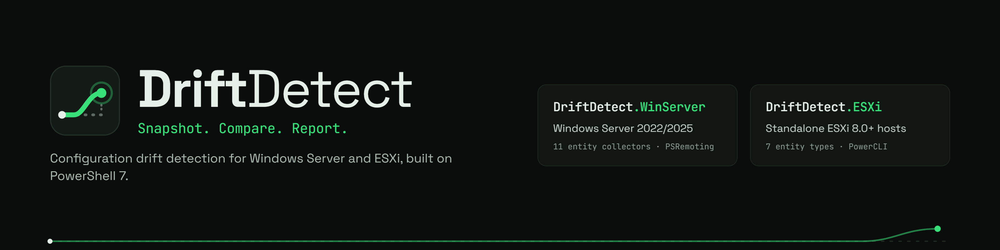

# DriftDetect.Core 1.0.1

Common snapshots, collection coverage, typed comparison, JSON persistence and HTML reporting. Requires PowerShell 7.0+. HTML export alone requires PSWriteHTML >=0.0.170.

Version 1.0.1 fixes CLIXML-remoted lists that also identify as PowerShell custom objects: collection interfaces take precedence over object properties. Empty, singleton, and ordered lists retain their array shape, without allocation metadata. Persisted snapshots are not rewritten; adapters must version affected collection contracts and require fresh baselines when capture shape changes.

## DriftDetect modules

Core supplies the common comparison engine, rules, snapshot format, and reports. Technology adapters collect configuration from their respective platforms.

| Module | Purpose |
|---|---|
| **DriftDetect.Core** | Shared snapshots, comparison rules, coverage, JSON persistence, and HTML reports |
| [DriftDetect.WinServer](https://github.com/Warezloder/DriftDetect.WinServer) | Windows Server configuration collection through PowerShell remoting; 16 collection units |
| [DriftDetect.ESXi](https://github.com/Warezloder/DriftDetect.ESXi) | ESXi configuration collection through PowerCLI; 19 collection units |

The banner illustrates the module family; the adapter READMEs document current collection coverage and exclusions.

## Getting started

Clone and import Core from source in PowerShell 7:

~~~powershell
git clone https://github.com/Warezloder/DriftDetect.Core.git
Import-Module .\DriftDetect.Core\DriftDetect.Core.psd1
~~~

For adapter use, place the sibling module directories under a directory on `PSModulePath`. You can add their parent to the current process without editing your profile:

~~~powershell
$moduleParent = (Resolve-Path .\DriftDetect.Core).Path | Split-Path -Parent
$env:PSModulePath = $moduleParent + [IO.Path]::PathSeparator + $env:PSModulePath
Import-Module DriftDetect.Core -MinimumVersion 1.0.1
# Once their repositories are cloned beside Core:
# Import-Module DriftDetect.WinServer
# Import-Module DriftDetect.ESXi
~~~

No global installation, PowerCLI connection, or PSWriteHTML import is needed for offline JSON and comparison. Install PSWriteHTML >=0.0.170 when exporting HTML reports. This repository provides source installation; a PowerShell Gallery package is not assumed.

## Common contract

Providers return entities with stable Id, EntityType, CollectionId, configuration Properties and operational Observations. Collection units explicitly record Success, Partial, Failed, Skipped, Unsupported or NotApplicable. Successful empty queries differ from failed queries.

~~~powershell
$rules = New-DDRuleSet -SeverityRules @(
    @{ Id='removed'; ChangeType='EntityRemoved'; Severity='High' }
)
$entity = New-DDEntity -EntityType Service -Id ssh -Name SSH -CollectionId Services -Properties @{ Policy='Off' } -Observations @{ Running=$false }
$unit = New-DDCollection -Id Services -Status Success -Entities @($entity)
$snapshot = New-DDSnapshot -Technology ESXi -Target @{ Id='host-uuid'; Name='esxi.example'; IdentitySource='HardwareUUID' } -Collections @($unit) -RuleSet $rules
Export-DDSnapshot -Snapshot $snapshot -Path .\snapshot.json
Export-DDConfigurationReport -Snapshot $snapshot -OutputPath .\configuration.html
~~~

Schema 2.0 includes effective rules, per-unit scope fingerprints, target identity, and coverage. Duplicate entity identities and invalid values are rejected. JSON uses literal paths, UTF-8, and a maximum supported value nesting depth of 64.

## Comparison

~~~powershell
$a = Import-DDSnapshot .\baseline.json
$b = Import-DDSnapshot .\current.json
$drift = Compare-DDSnapshot $a $b
Export-DDDriftReport -DriftResult $drift -OutputPath .\drift.html
~~~

Strict comparison refuses different targets, incompatible scopes/rules, or incomplete applicable collection units. **-AllowPartial** compares only successful units with matching scope and contract versions. Inspect **IsComplete** alongside **HasDrift**: zero observed changes in an incomplete comparison is inconclusive.

**TotalChanges** counts all events, including whole-entity additions/removals. TotalModified, TotalNew, and TotalDeleted partition that count. Changes, NewEntities, and DeletedEntities remain compatibility views. SeveritySummary includes all event types.

Maps compare recursively with case-sensitive keys and strings. Null, absent, empty arrays/strings, booleans, numeric values and numeric strings remain distinct. Equivalent JSON numeric representations compare equally. Array policies are Ordered (default), Set (ignores order and duplicate identical entries), and Keyed (matches map members by a scalar key). Observations never cause configuration drift.

## Declarative rules

~~~powershell
$rules = New-DDRuleSet -ComparisonPolicies @(
    @{ Id='members'; EntityType='LocalAccount'; PropertyPath='/Members'; Mode='Set' }
    @{ Id='trusts'; EntityType='Domain'; PropertyPath='/Trusts'; Mode='Keyed'; Key='TrustedDomain' }
) -SeverityRules @(
    @{ Id='password'; EntityType='AdvancedSetting'; EntityName='Security.PasswordQualityControl'
       PropertyPath='/Value'; Severity='High' }
)
~~~

Severity selectors are Technology, EntityType, EntityName, EntityId, PropertyPath, and ChangeType. Omitted selectors mean *. Paths use JSON Pointer escaping. Highest Priority wins, then most specific match; equal ranked contradictory rules are errors. Comparison policy paths may use * for keyed member segments. Rules contain data, never commands.

Rules are embedded in snapshots. Policy changes require an explicit override applied to both snapshots; this cannot recover omitted data. Import-DDRuleSet also translates legacy severity-only files.

## Reports and migration

Configuration reports contain all captured settings, separate observations, and coverage. Drift reports contain coverage, events, old/new values and severity. Both retain selection/exclusion notices, embed assets, escape untrusted text and support filtering without network access. Date-looking configuration strings remain strings during JSON import.

> [!warning]
> Schema 1 snapshots remain readable for inspection/reporting, but cannot be compared. Capture a fresh baseline with the same scope as subsequent captures. Legacy drift-result reports mark completeness unknown.

Technology packages 2.0 retain cmdlet names and parameters but replace public classes with plain common objects. Replace the snapshot Export method with Export-DDSnapshot. Retained Classes directories are inactive legacy source.

The Windows adapter omits task arguments unless the exact full task path appears in TaskArgumentAllowList. Omitted arguments have no persisted content or hash and are not compared. An allowlist authorizes persistence of reviewed non-secret arguments.

## Verification

From this repository's root, run the Core tests with Pester 5 and PSWriteHTML installed:

~~~powershell
Import-Module Pester -MinimumVersion 5.0
Invoke-Pester -Path .\Tests -Output Detailed
~~~

Tests cover typed comparison, collection coverage, remoting serialization, persistence, and HTML output. No credentials or live connections are needed. The combined development workspace passed 177 tests, plus 36 Windows provider tests under PowerShell 5.1. Read-only live checks also confirmed clean remoted DNS arrays and SSH state capture in the adapters; these do not replace platform-specific coverage testing.

## Thanks to PSWriteHTML

DriftDetect's configuration and drift reports are built with [PSWriteHTML](https://github.com/EvotecIT/PSWriteHTML). A big thank-you to the [Evotec team](https://github.com/EvotecIT) and the project's contributors for making rich reporting accessible from PowerShell.

PSWriteHTML helps turn PowerShell data into interactive tables, dashboards, charts, diagrams, HTML pages, and emails without having to build the HTML, CSS, and JavaScript yourself. Their work gives PowerShell authors more time to focus on the information they want to share.

Explore the [examples](https://github.com/EvotecIT/PSWriteHTML/tree/master/Examples) and [documentation](https://github.com/EvotecIT/PSWriteHTML#readme). If their tools help you, consider starring the project, sharing what you build, or contributing fixes and documentation. DriftDetect benefits from that work, and we're grateful for it.

## License

[MIT](LICENSE), matching the DriftDetect technology modules.
